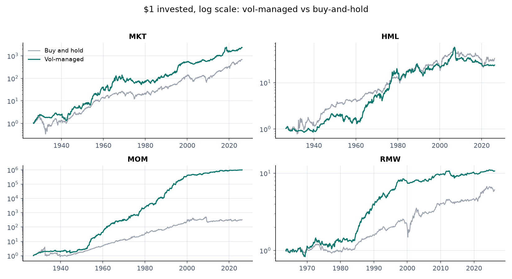
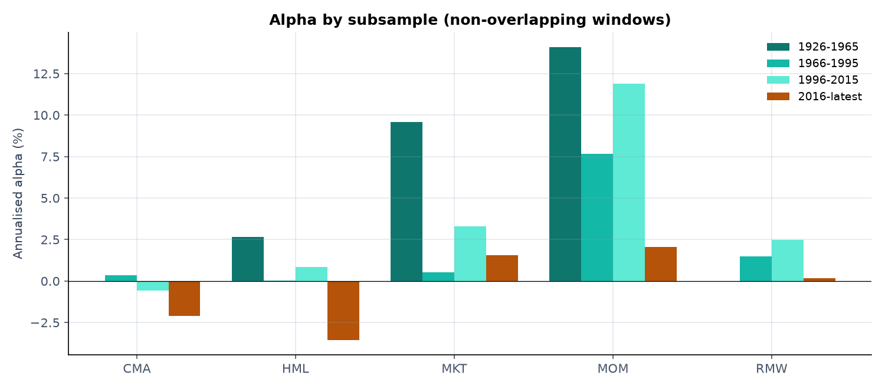

# Volatility-Managed Portfolios: Replication and Out-of-Period Evidence

[](https://github.com/Jinay6/volatility-managed-portfolios/actions/workflows/tests.yml)

A replication of **Moreira & Muir (2017), "Volatility-Managed Portfolios", *Journal of Finance* 72(4)**, using public
Fama-French factor data, extended with ten years of post-publication data, non-overlapping subsamples and
multifactor spanning tests.

**Question.** If an investor scales factor exposure *down* after volatile months and *up* after calm ones, does
risk-adjusted performance improve and is the improvement genuine alpha?



## Method

For each factor *f* (Mkt-RF, HML, MOM, RMW, CMA):

1. **Realised variance** of month *t* is the sum of squared daily returns, RV<sub>t</sub> (months with fewer than 15 trading days are dropped).
2. **Volatility-managed return:** f<sup>σ</sup><sub>t+1</sub> = (c / RV<sub>t</sub>) · f<sub>t+1</sub>. Only information available at the end of month *t* is used.
   The constant *c* equalises the unconditional variance of f<sup>σ</sup> and *f*, so Sharpe ratios are directly comparable.
3. **Alpha test:** f<sup>σ</sup><sub>t+1</sub> = α + β f<sub>t+1</sub> + ε. A positive α means the managed strategy expands the
   mean-variance frontier relative to holding the factor. All t-statistics use **Newey-West (HAC, 6 lags)** standard errors.
4. **Robustness:** original vs extended sample, four non-overlapping subsamples, a predictability regression
   (does RV<sub>t</sub> predict r<sub>t+1</sub>?), and a **spanning test** against all five factors jointly, estimated on the same months.

## Results

**Replication (paper sample, 1926 to 2015).** The headline result reproduces: the vol-managed market earns
α = 4.7% per year (t = 2.80), and vol-managed momentum earns α = 12.7% (t = 6.43), with its Sharpe ratio roughly doubling (0.49 → 1.00).

| Factor | Sharpe (orig) | Sharpe (vol-managed) | α (%/yr) | t(α) |
|---|---:|---:|---:|---:|
| MKT | 0.42 | 0.51 | 4.68 | 2.80 |
| HML | 0.39 | 0.35 | 1.73 | 1.49 |
| MOM | 0.49 | 1.00 | 12.71 | 6.43 |
| RMW | 0.40 | 0.56 | 2.50 | 2.75 |
| CMA | 0.52 | 0.38 | 0.17 | 0.27 |

Full tables, including the extended sample through the latest available data, are in [`results/tables/`](results/tables).

**What the extensions add:**

- **The effect is concentrated in turbulent periods and has faded since publication.** In 2016 onwards, no factor's
  vol-managed alpha is statistically significant, and HML and CMA are negative
  ([`subsample_alpha.csv`](results/tables/subsample_alpha.csv)). The market alpha is large in 1926 to 1965 (9.6%, t = 3.0)
  but insignificant in every later window.
- **Spanning (same 1963+ sample).** Momentum (α = 10.1%, t = 5.1) and profitability (α = 2.8%, t = 3.5) keep significant
  alpha after controlling for all five factors. The market's alpha is already insignificant on this sample (2.7%, t = 1.5)
  and falls to 0.5% once the other factors are included, so the market result depends on the pre-1963 data.
- **Mechanism.** Last month's variance does not significantly predict next month's market return (t = 0.17), which is
  why scaling down after high variance raises the conditional Sharpe ratio.



## Limitations

- **In-sample scaling.** *c* is chosen on the full sample (the paper's convention). This does not change Sharpe ratios
  or alpha t-statistics, but a real-time investor would not know *c*. Cederburg et al. (2020, *JFE*) show that
  out-of-sample utility gains are much weaker.
- **No transaction costs or leverage constraints.** The managed strategy can take weights well above 1 in calm months.
- **The multifactor Sharpe ratios** in `combination.csv` come from an in-sample tangency portfolio and are optimistic.
- Only factors available in the French Data Library are included. The paper's ROE, BAB and currency-carry factors are omitted.

## Reproduce

```bash
conda env create -f environment.yml   # or: pip install -e ".[dev]"
conda activate volmanaged
python -m volmanaged                  # downloads data, writes results/tables and results/figures
pytest                                # unit tests
```

Data are downloaded on first run from the [Kenneth R. French Data Library](https://mba.tuck.dartmouth.edu/pages/faculty/ken.french/data_library.html)
and cached in `data/raw/` (not committed). Results will update slightly as the library adds new months.

## Project structure

```
src/volmanaged/
├── data.py       download and parse French-library CSVs
├── strategy.py   realised variance and volatility-managed returns
├── stats.py      alpha, spanning, predictability regressions (Newey-West)
├── plots.py      figures
└── pipeline.py   end-to-end run (python -m volmanaged)
tests/            unit tests (parsing, timing and no look-ahead, variance matching, alpha recovery)
results/          generated tables and figures
```

## Reference

Moreira, A., & Muir, T. (2017). Volatility-managed portfolios. *The Journal of Finance*, 72(4), 1611–1644.

## License

MIT. See [LICENSE](LICENSE).
